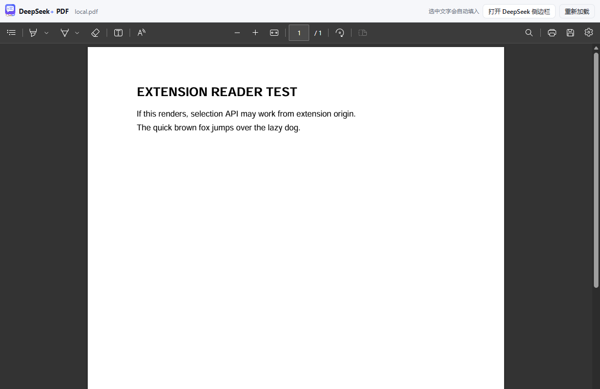

# DeepSeek 侧边栏增强版（非官方）

在 Microsoft Edge 侧边栏里使用 DeepSeek，并补上原版缺少的几件事：

- **读取当前网页正文**：一键提取当前标签页的标题、链接和正文，预览后可以整理成 `.txt` 文件附加给 DeepSeek，或直接填入输入框。
- **划词自动填入 / 取消自动撤回**：高亮选中文字就自动填入 DeepSeek 输入框，不需要右键；取消选区（点击空白处或按 Esc）会自动删掉这次自动填入的文字并恢复之前的草稿；如果你已经手动改过输入框，则不会误删。
- **PDF 支持**：读取 PDF 时把文件附加到 DeepSeek，由 DeepSeek 自己解析；在 Edge 内置 PDF 阅读器里划词也能自动填入。
- **引用对话**：在 DeepSeek 回复里选中文字，点浮出的“引用”按钮（或右键“引用到 DeepSeek 输入框”），会以 `>` 引用格式插入输入框。
- **提示词库**：保存当前输入为提示词，支持搜索、编辑、置顶、删除和 JSON 导入/导出；数据模型参考 Voyager 的 Saved Library。

> 非官方扩展，与 DeepSeek 官方无关。基于你已安装的 **Deepseek Chat Sidebar (Unofficial) v1.0** 重写增强。  
> GitHub: https://github.com/lllhcbjj/deepseek-sidebar-plus · 隐私政策: https://lllhcbjj.github.io/deepseek-sidebar-plus/privacy.html


## 原版源码说明

你安装的商店版扩展 ID 是 `nohnmlomaejjhleigmkbcdebkcidnpjd`，实际文件位于：

```text
%LOCALAPPDATA%\Microsoft\Edge\User Data\<Profile>\Extensions\nohnmlomaejjhleigmkbcdebkcidnpjd\1.0_0
```

原版真正生效的代码只有四个文件：

| 文件 | 作用 |
| --- | --- |
| `manifest.json` | MV3 清单，声明 `tabs`、`sidePanel`、`declarativeNetRequestWithHostAccess` |
| `background.js` | 点击图标时打开侧边栏 |
| `rules.json` | 删除 `chat.deepseek.com` 的 `X-Frame-Options` / CSP，使其可被 iframe 嵌入 |
| `sidebarIframe.html` | 一个占满侧边栏的 `<iframe src="https://chat.deepseek.com">` |

原版里还有一个 `sidebar.js`，但它引用的是不存在的 DOM，属于早期“自建聊天界面/API 客户端”的遗留文件，实际没有被任何页面加载。

商店版扩展文件受 Edge 校验保护，不能稳定地原地修改；本目录是从原版思路重写出来的**未打包扩展**，可以自由修改、重新加载。

## 功能

### 1. 读取当前网页

- 点击侧边栏顶部的 **读本页**。
- 自动提取当前标签页的标题、链接、站点名、作者、正文，并打开预览。
- 预览底部提供：
  - **文件提问**：把完整网页正文整理成 `.txt` 文件，通过 DeepSeek 的文件上传入口附加到对话，输入框只留下“请阅读我上传的网页内容文件《…》，然后回答我的问题：”。
  - **总结本页**：同样附加 `.txt` 文件，但输入框只放总结指令。
  - **直接填入**：保留旧行为，把“网页信息 + 正文”直接写进输入框（受字数上限限制）。
  - **复制**：复制正文到剪贴板。
- 文件附件会保留完整正文，最多提取 50,000 字；截图里的 GitHub 长页面会完整放进文件，不再把整页塞进输入框。
- 支持两种提取方式（设置里切换）：
  - **智能正文**（默认）：优先取 `article/main` 等正文容器，去掉导航、侧栏、广告、页脚、评论区，并转成 Markdown 风格文本。参考了元宝尝鲜版 `GetPageHTML` 使用 `document.body.innerText` 的做法：如果候选正文只覆盖整页不到 45%，会自动回退到整页文本，避免“读了个开头就没了”。
  - **整页文本**：直接使用 `document.body.innerText`，与元宝/常见页面上下文的思路一致，适合正文识别不理想的页面。
- 设置里的 6,000 / 12,000 / 20,000 / 30,000 字上限只作用于 **直接填入**；文件提问/总结本页不受该上限影响（提取上限 50,000 字）。


> 页面读取参考：本机安装的 Voyager 只作用于 Gemini 页面，没有通用页面读取；元宝尝鲜版的 `GetPageHTML` 直接返回 `document.body.innerText`，Gemini 的页面上下文本质上也类似。本扩展默认用智能正文降噪，但覆盖不足时会自动回退到整页文本。

### 2. PDF 读取与划词

- **读取 PDF**：在 Edge 里打开 PDF，点击侧边栏的 **读本页**。扩展会下载这个 PDF（最大 50 MB），通过 DeepSeek 自己的文件上传入口附加到对话里，并填入“请阅读我上传的 PDF…”提示词。之后由 **DeepSeek 自己解析 PDF**，不用本地硬解文本。元宝尝鲜版的页面脚本也是把 `.pdf` 排除在网页提取之外，PDF 走自己的文件解析链路；本扩展采用同样的分工。
- 如果 PDF 的网址不带 `.pdf` 后缀，`page-tools.js` 检测到页面里的 PDF `<embed>` 后也会走同一套“下载并附加”流程。
- **PDF 划词**：在 Edge 内置 PDF 阅读器里选中文字，扩展通过 PDF 阅读器的 `embed.postMessage({type:'getSelectedText'})` 接口读取当前选区，自动填入 DeepSeek；取消选区后同样自动撤回。这个接口只允许页面主世界调用，所以 `pdf-main.js` 会作为 web-accessible script 注入 PDF 页面。不同 Edge 版本的 PDF 阅读器内部接口可能变化；本版在 Edge 154 验证通过。
- **本地 `file://` PDF 的自动方案**：Edge 原标签页在 `file://` 下是不透明源（opaque origin），`getSelectedText` 回复会被浏览器丢弃，所以直接在原 PDF 标签页里选中不会自动。侧边栏检测到本地 PDF 时会显示提示条，点 **打开增强阅读器** 即可在一个新标签页里用扩展内的 Edge 原生 PDF 阅读器打开同一份 PDF；阅读器页面是 `chrome-extension://` 源，选区 API 可用，所以**选中自动填入、取消选中自动撤回**都正常。也可以从设置里的 **用增强阅读器打开当前 PDF** 进入。
- 如果只想快速取一段文字，仍可选中后 `Ctrl+C`，点侧边栏工具栏的 **剪贴板** 按钮填入；或者用“读本页”把 PDF 附件发给 DeepSeek 解析。


- 扫描版/纯图片 PDF 由 DeepSeek 的解析能力处理；如果 DeepSeek 没读出文字，需要换带文字层的 PDF 或在 DeepSeek 里手动上传。

### 3. 划词自动填入

- 在任意普通网页中高亮选中文字，约 0.2 秒后自动填入 DeepSeek 输入框，**不需要右键**。
- 取消选区（点击页面空白处、按 Esc，或把选区折叠）会自动撤回这次自动填入：如果填入前输入框里有草稿，会恢复草稿；如果是覆盖模式，会恢复填入前的内容。
- 如果填入后你已经手动编辑过输入框，取消选区**不会**删除你的修改。
- 右键菜单仍然保留，作为可选的手动入口。
- 默认是 **智能追加**：
  - 输入框为空：直接填入。
  - 输入框里是你自己写的内容：追加到后面，保留草稿。
  - 输入框里是上一次自动填入的内容：替换掉，不会反复堆叠。
- 也可以切换为“覆盖”或“追加”。
- 侧边栏未打开时，选中文字会暂存在扩展里；再次打开侧边栏会自动填入。网页右下角会显示“已暂存”提示。
- 侧边栏已打开时，网页右下角提示“已发送到 DeepSeek 侧边栏”。
- 在输入框、文本域、网页编辑器里选字不会触发，避免误抓隐私内容。
- 右键菜单也支持：
  - 选中文字后右键 → **发送选中文字到 DeepSeek 侧边栏**
  - 页面空白处右键 → **读取本页正文到 DeepSeek**

### 4. 引用 DeepSeek 对话

- 在 DeepSeek 的回复或对话内容里选中文字，选区附近会出现一个 **“❝ 引用”** 浮动按钮，点一下就会以 `>` 引用格式插入输入框。
- 选中后右键 → **引用到 DeepSeek 输入框**，同样可用。
- 多行内容会逐行加 `>`；输入框已有草稿时追加到后面，并留出空行方便继续提问。
- 在输入框/编辑器里选字不会出现引用按钮。

### 5. 提示词库

- 点工具栏的 **提示词库**（书签图标）打开。
- **保存当前输入**：读取 DeepSeek 输入框当前内容，填写名称/标签后保存；也可以直接编辑提示词内容。
- **搜索**：按名称、内容或标签过滤。
- **填入**：一键把提示词写回 DeepSeek 输入框。
- **编辑 / 置顶 / 删除**：置顶项排在最前。
- **导入 / 导出 JSON**：参考 Voyager 的 Saved Library 数据模型（`id`、`name`、`text`、`tags`、`pinnedAt`、`createdAt`、`updatedAt`），方便备份和迁移。
- 提示词保存在 `chrome.storage.local` 的 `promptLibrary` 键下。

### 6. 设置

- 划词自动填入开关（工具栏上的“划词”按钮也可以快速开关）。
- 填入方式：智能追加 / 覆盖 / 追加。
- 附带网页来源：划词时在文字后附加页面标题和链接。
- 网页内轻提示开关。
- 读取网页方式：智能正文 / 整页文本。
- 直接填入字数上限（文件附件不受此限制）。
- 工具栏 **剪贴板** 按钮：读取剪贴板并填入，适合本地 PDF 或无法划词的页面。
- 填入当前选中文字、在标签页打开 chat.deepseek.com、用增强阅读器打开当前 PDF、在标签页打开侧边栏（移动/分屏）、重新加载 DeepSeek、恢复默认设置。


## 安装（Edge）

1. 把 ZIP 解压到一个**固定的文件夹**（例如 `D:\EdgeExtensions\DeepSeekSidebar`），确保 `manifest.json` 就在该文件夹根目录。
2. 打开 `edge://extensions/`。
3. 打开左下角的 **开发人员模式**。
4. 点击 **加载解压缩的扩展**，选择解压后包含 `manifest.json` 的文件夹。
5. 在扩展列表里把 **DeepSeek 侧边栏增强版** 固定到工具栏。
6. 点击图标打开侧边栏；首次加载时按提示允许权限。
7. 建议在 `edge://extensions/` 里**停用或移除原来的 Deepseek Chat Sidebar**，避免两个侧边栏同时存在。

更完整的分享/安装/更新说明见 [INSTALL.md](INSTALL.md)。给他人使用时，发 `deepseek-sidebar-plus-v1.8.0-portable.zip`（含安装说明、隐私政策和扩展文件）即可；不要只发开发目录里的零散文件。

> 直接双击 ZIP 不会安装扩展；Edge 需要选择解压后的文件夹。解压/移动文件夹会改变未打包扩展的 ID，原来的设置和提示词库不会自动跟过去。

修改文件后，在 `edge://extensions/` 的扩展卡片上点 **重新加载** 即可生效。已经打开的网页需要刷新一次，新的内容脚本才会注入。

## 移动端 / 窄屏

- 侧边栏 UI 已适配 **320–430px**：工具栏图标化、触摸目标加大、底部安全区、提示词库/设置面板可全宽滚动、移动端 PDF 阅读器顶栏自动换行。
- **Edge 官方手机版通常不支持这类桌面扩展（尤其是 sidePanel API）**，这是浏览器限制，不是脚本问题；iPhone/Edge iOS 也不支持 Chromium 扩展。
- 在 **Android Kiwi Browser** 等支持 Chromium 扩展的浏览器里可以加载本扩展；如果没有 `sidePanel` API，点扩展图标会自动退化为全页侧边栏，也可以点设置里的 **在标签页打开侧边栏（移动/分屏）**，或直接访问 `chrome-extension://<扩展ID>/src/sidebar.html`。
- 桌面端窄窗口、分屏、平板也可以直接用这套响应式布局。

## Edge 商店提交材料

v1.8.0 已按 Microsoft Edge Add-ons 的要求做了商店候选版：

- 名称和描述改为 `_locales/en`、`_locales/zh_CN` 本地化，名称明确带 **Unofficial / 非官方**。
- 完整提交工作表：[STORE_SUBMISSION.md](STORE_SUBMISSION.md)
- 隐私政策：[docs/privacy.html](docs/privacy.html)、[PRIVACY.md](PRIVACY.md)
- 商店 Logo 和宣传图：[docs/store/](docs/store/)
- 最小商店包：`deepseek-sidebar-plus-v1.8.0-store.zip`

**商店提交前还需要：**

1. 隐私政策已发布在 `https://lllhcbjj.github.io/deepseek-sidebar-plus/privacy.html`（源码 `docs/privacy.html`，GitHub Pages 从 `/docs` 发布）。
2. 用真实登录的 DeepSeek 截 1–6 张 1280×800 或 640×480 的截图。
3. 准备测试账号或在认证备注中说明“需要用户自己的 DeepSeek 账号”。
4. 按 `STORE_SUBMISSION.md` 的权限说明、数据使用披露和认证备注填写。

当前商店包仍是**全功能版**（包含 `<all_urls>`、剪贴板和 DNR 规则）；如果审核因为权限或 iframe 拒绝，下一步再做 optional host permissions 的低风险版本。

## 登录

侧边栏里加载的就是 `https://chat.deepseek.com`，可以直接在侧边栏内登录：

- 手机号验证码登录
- 微信扫码登录（二维码在侧边栏内）
- 密码登录 / Apple 登录

如果侧边栏内登录不方便，点设置里的 **在标签页打开 chat.deepseek.com**，在普通标签页登录完成后回到侧边栏点 **重新加载 DeepSeek**。同一浏览器配置文件下 Cookie 是共享的。

> 未登录时 DeepSeek 页面没有聊天输入框，填入操作会提示“没有找到输入框”，这是正常现象。

## 权限说明

| 权限 | 用途 |
| --- | --- |
| `host_permissions: <all_urls>` | 在任意网页上捕获划词、读取当前页正文，以及下载你点击“读本页”的 PDF。内容脚本平时不做事，只在你划词或点击“读本页”时运行。 |
| `tabs` | 获取当前标签页的标题、URL，向页面发送提取/取词消息。 |
| `sidePanel` | 打开侧边栏、设置侧边栏页面。 |
| `scripting` | 对安装扩展前就已打开的页面，按需注入提取脚本。 |
| `storage` | 保存设置和待填入的划词。 |
| `contextMenus` | 右键菜单。 |
| `clipboardRead` | 工具栏“从剪贴板填入”，用于 Edge 无法读取选区的本地 PDF。 |
| `clipboardWrite` | 复制网页正文。 |
| `declarativeNetRequestWithHostAccess` | 移除 `chat.deepseek.com` 的 `X-Frame-Options` / CSP，让 DeepSeek 能嵌入侧边栏（与原版一致）。 |
| `web_accessible_resources`（`pdf-main.js`） | 在 PDF 页面主世界读取 Edge 阅读器当前选区；只监听 PDF 选区，不读取页面其他内容。 |

扩展自身代码没有独立的远程上报；网页正文只在你主动读取/划词时进入扩展，填入输入框，只有你在 DeepSeek 里点击发送时才会发给 DeepSeek。PDF 是例外：你点击“读本页”时，PDF 文件会被下载并附加到 DeepSeek，由 DeepSeek 解析；扩展不会在后台扫描你的 PDF。侧边栏内嵌的 `chat.deepseek.com` 是 DeepSeek 的网页，它仍会按 DeepSeek 自己的隐私政策联网。

## 目录结构

```text
deepseek-sidebar-plus/
├─ manifest.json                 MV3 清单
├─ background.js                 侧边栏、右键菜单、待填入状态、页面提取调度
├─ rules.json                    仅作用于 chat.deepseek.com 的响应头规则
├─ src/
│  ├─ sidebar.html               侧边栏页面（工具栏 + iframe + 预览/设置面板）
│  ├─ sidebar.css                侧边栏 UI
│  ├─ sidebar.js                 iframe 通信、划词填入、页面预览、设置、PDF 阅读器入口
│  ├─ pdf-reader.html            本地 PDF 增强阅读器页面
│  ├─ pdf-reader.css             阅读器 UI
│  ├─ pdf-reader.js              读本地 PDF + 原生阅读器选区转发
│  └─ content/
│     ├─ page-tools.js           普通网页内容脚本：划词捕获 + 正文提取 + PDF 桥接
│     ├─ pdf-main.js             PDF 页面主世界脚本：读取 Edge PDF 阅读器选区
│     └─ chat-bridge.js          DeepSeek iframe 内容脚本：写入输入框 + 附加文件
├─ icons/                        16/32/48/128 图标
├─ _locales/
│  ├─ en/messages.json           英文名称/描述（Unofficial）
│  └─ zh_CN/messages.json        中文名称/描述（非官方）
├─ docs/
│  ├─ privacy.html               可托管的隐私政策页面
│  ├─ reader.png                 PDF 阅读器截图
│  └─ store/                     商店 Logo、宣传图、生成脚本
├─ PRIVACY.md                    隐私政策摘要
└─ STORE_SUBMISSION.md           Edge Add-ons 提交流程、权限说明、认证备注
```

## 实现要点

- 侧边栏页面和 `chat.deepseek.com` 是跨域的，父页面不能直接读 iframe DOM。因此：
  - `chat-bridge.js` 注入 `chat.deepseek.com` iframe，监听 `postMessage`，找到输入框并写入文本。
  - 写入使用原生 `HTMLTextAreaElement.prototype.value` setter + `input`/`change` 事件，兼容 React 受控输入框；同时支持 `contenteditable`（`execCommand('insertText')` 兜底）。
  - 父页面只接受 `event.origin === 'https://chat.deepseek.com'` 且 `event.source === iframe.contentWindow` 的消息。
- 划词捕获在 `page-tools.js`，用 `pointerup` / `keyup` 触发，160ms 防抖；忽略表单控件内的选择。
- 每个选区有唯一 `selectionId`。取消选区时发送 `DS_PAGE_SELECTION_CLEARED`，侧边栏让 `chat-bridge.js` 恢复自动填入前的值；只有当前输入仍等于自动填入结果时才撤销，用户手动改过就保留修改。页面失焦到侧边栏时不会误判为取消选区。
- 正文提取先按 `article/main/.post-content` 等候选容器打分（文本长度、段落数、链接密度、正负类名），再递归转 Markdown；候选覆盖不足 45% 时回退整页文本。这参考了元宝尝鲜版直接把 `document.body.innerText` 交给服务端的做法，也保留了智能正文的降噪能力。
- **网页文件提问**：侧边栏把标题、链接、站点信息和完整正文组装成 `.txt`，通过 `DS_ATTACH_FILE` 把 `ArrayBuffer` transfer 给 `chat-bridge.js`，写入 DeepSeek 文件输入框；输入框只保留一句“请阅读我上传的网页内容文件…”。`chat-bridge.js` 会按文件扩展名/MIME 选择接受该类型的 `input[type=file]`，没有输入框时退回 `drop`。
- **PDF 读取**：`background.js` 识别 `.pdf` URL；如果 URL 没有后缀，`page-tools.js` 检测页面里的 `<embed type="application/pdf">` 并返回 `pdf-tab`。侧边栏用 `fetch` 下载 PDF（带 Cookie、检查 `%PDF` 魔数、限制 50 MB），把 `ArrayBuffer` 通过 `postMessage` transfer 给 `chat-bridge.js`；后者构造 `File`，写入 DeepSeek 的 `input[type=file]`，走 DeepSeek 自己的上传/解析流程。若没有文件输入框，会尝试向编辑器派发 `drop` 事件。
- **PDF 划词**：`pdf-main.js` 在 PDF 页面主世界轮询 `embed.postMessage({type:'getSelectedText'})`，把 `getSelectedTextReply.selectedText` 通过 `window.postMessage` 转给 `page-tools.js`，再走普通划词链路。只有主世界能调用该接口。
- **本地 PDF 增强阅读器**：`pdf-reader.js` 用扩展页面的 `fetch` 读取 `file://` PDF，创建 `blob:` URL，并把 Edge 原生 PDF `<embed>` 放进扩展页面；由于页面是 `chrome-extension://` 源，选区 API 正常工作。阅读器轮询选区并直接 `chrome.runtime.sendMessage` 给 background，复用同一套自动填入/取消撤回逻辑。
- 侧边栏关闭时，划词暂存在 `chrome.storage.session`，重新打开后由 `requestPending` 取出并自动填入。
- 扩展不自动点击 DeepSeek 的发送按钮，只负责把内容/文件放进输入区，发送前你可以继续编辑。

## 调试

- 侧边栏页面的控制台会输出 `[DS+]` 前缀日志，例如 `bridge ready`、`fill result`。
- 在扩展页面（或 `chrome-extension://<扩展ID>/src/sidebar.html`）里可以直接用测试钩子：

  ```js
  window.__DS_TEST__.settings
  window.__DS_TEST__.pageData
  window.__DS_TEST__.bridgeReady
  await window.__DS_TEST__.fillChat('测试文字', 'replace')
  await window.__DS_TEST__.extractAndShow()
  ```

- 检查内容脚本是否注入：
  - 普通网页：`document.documentElement.dataset.dsPageTools === '1'`
  - DeepSeek iframe：`document.documentElement.dataset.dsChatBridge === '1'`
  - PDF 页面主世界：`document.documentElement.dataset.dsPdfBridge === '1'`
- 如果 DeepSeek 改版导致输入框找不到，修改 `src/content/chat-bridge.js` 里的 `findInput()` 选择器。
- 如果 PDF 附加失败，检查 `chat-bridge.js` 里的 `findFileInput()` / `findDropTarget()`，以及 DeepSeek 是否仍有 `input[type=file]`。
- 如果某站正文提取不理想，优先在设置里切换“整页文本”；也可以调整 `src/content/page-tools.js` 里的候选选择器和打分规则。

## 已知限制 / FAQ

**Q：点“读本页”提示不允许读取？**  
`edge://` 内部页面、Edge 扩展商店等受浏览器保护，内容脚本无法注入。切换到普通网页即可。PDF 请按下面的 PDF 流程处理。

**Q：侧边栏里没有输入框？**  
先登录。登录后如果仍未出现，点连接状态圆点或设置里的“重新加载 DeepSeek”。

**Q：划词没有反应？**  
- 看工具栏“划词”按钮是否开启（高亮状态）。
- 侧边栏关着时只暂存，需要重新打开侧边栏才会填入。
- 在网页输入框/编辑器里选字会被忽略。
- 极少数页面（浏览器内部页）没有内容脚本。
- PDF 见下面的 PDF 问题。

**Q：取消高亮后输入框文字没有删除？**  
只有“自动填入”且输入框没有被手动修改过时才会自动撤回。如果填入后你编辑过输入框，会保留你的修改；如果侧边栏当时是关闭状态，iframe 已经卸载，重新打开后可能需要手动清空。点击页面空白处或按 Esc 让页面重新获得焦点后再试一次。

**Q：PDF 点“读本页”没反应？**  
- 先登录 DeepSeek；PDF 是通过 DeepSeek 自己的上传入口附加的，未登录时没有文件输入框。
- PDF 必须是可访问的 `http(s)://` / `file://` 地址，且不超过 50 MB；需要登录权限的 PDF 会带上 Cookie 下载。
- 如果链接是 `blob:`、临时签名地址或下载后是登录页，扩展会提示“不是 PDF”。可以先把 PDF 下载到本地，在 DeepSeek 输入框里手动点附件上传。
- PDF 附加后需要等 DeepSeek 解析完成，再点发送。

**Q：PDF 划词没反应？**  
- 网页 PDF：在 Edge 内置 PDF 阅读器里选中文字，约 1 秒内自动填入。
- 本地 `file://` PDF：原标签页受 Edge 限制，自动划词不可用；侧边栏会出现“打开增强阅读器”提示，点一次用扩展内的阅读器打开同一份 PDF，就能自动选中/撤回。
- 增强阅读器打不开或空白：在 `edge://extensions` 的扩展详情里开启 **允许访问文件网址**，再刷新阅读器。
- 更新扩展后，已经打开的 PDF 需要刷新一次，`pdf-main.js` 才会注入。
- PDF 加密或扫描件可能没有可选择的文字层；这种情况请用“读本页”把 PDF 附加给 DeepSeek。

**Q：页面内容读取不完整？**  
默认的“智能正文”会刻意去掉导航、广告、评论区；如果它只覆盖整页不到 45%，会自动改用整页文本。也可以直接在设置里切换“整页文本”。文件附件最多保留 50,000 字，超出会在文件里注明截断。

**Q：文件提问后输入框只有一句话，正文去哪了？**  
正文已经作为 `.txt` 文件附加到 DeepSeek，输入框只保留简短问题。等文件解析完成后再发送，或继续修改问题。

**Q：文件提问失败？**  
先确认侧边栏已登录、输入框正常。DeepSeek 可能拒绝该文件类型或大小；提示条里会提供 **改为直接填入** 的退路，或者用“直接填入”按钮。文件附件依赖 DeepSeek 的文件上传入口，和 PDF 附加是同一套机制。

**Q：为什么需要“读取所有网站数据”的权限？**  
因为要在任意网页上划词和读取正文。扩展没有远程服务，代码里只有 `chrome.*` 调用和侧边栏 iframe 的 `postMessage`；可以自行审查本目录源码。

**Q：原版扩展还能用吗？**  
可以，但两个侧边栏会重复。本增强版使用不同的扩展 ID，不会覆盖商店版；建议停用原版。

**Q：更新扩展后设置丢了？**  
设置保存在扩展 ID 对应的 `chrome.storage.local`。只要从同一目录加载，ID 不变，设置会保留；移动目录可能导致 ID 变化。

## 版本

- **v1.8.0**：Edge Add-ons 商店候选准备：名称加“非官方”、en/zh 本地化、隐私政策、权限说明、商店文案、Logo 和宣传图；商店包不包含开发文档。
- **v1.7.0**：移动端/窄屏适配：320–430px 响应式布局、触摸目标、安全区、移动端 PDF 阅读器顶栏；新增“在标签页打开侧边栏（移动/分屏）”。
- **v1.6.0**：新增 DeepSeek 对话内容引用（浮动“引用”按钮 + 右键菜单）和提示词库（保存当前输入、搜索、编辑、置顶、删除、JSON 导入/导出）。
- **v1.5.0**：网页读取新增“文件提问/总结本页”：把完整正文整理成 `.txt` 附加到 DeepSeek，输入框只保留简短问题；网页提取上限提高到 50,000 字，设置里的字数上限只作用于“直接填入”。
- **v1.4.0**：新增本地 PDF 增强阅读器：在扩展页面内用 Edge 原生阅读器打开本地 PDF，恢复自动划词/取消撤回；侧边栏提示条和设置入口可直接打开。
- **v1.3.1**：新增工具栏“从剪贴板填入”，解决 Edge 本地 `file://` PDF 无法自动读取选区的问题；补充本地 PDF 限制说明。
- **v1.3.0**：划词改为实时同步：选中即填入，取消选区自动撤回并恢复填入前的草稿；用户手动修改过输入框时不误删；PDF 划词同样支持。
- **v1.2.0**：增加 PDF 读取（下载 PDF → 附加到 DeepSeek 文件输入 → 由 DeepSeek 解析）和 PDF 划词（Edge 阅读器 `getSelectedText` 主世界桥接）；网页正文增加覆盖不足自动回退整页文本。
- **v1.1.0**：在原版 iframe 侧边栏基础上增加网页正文读取、划词自动填入、智能追加、右键菜单、待填入暂存、设置面板、连接状态与重试。
- 原版：v1.0（2025 年前后的商店版本，仅 iframe 包装）。

---

图标沿用原扩展；本项目仅用于个人学习与自用，非官方产品。
